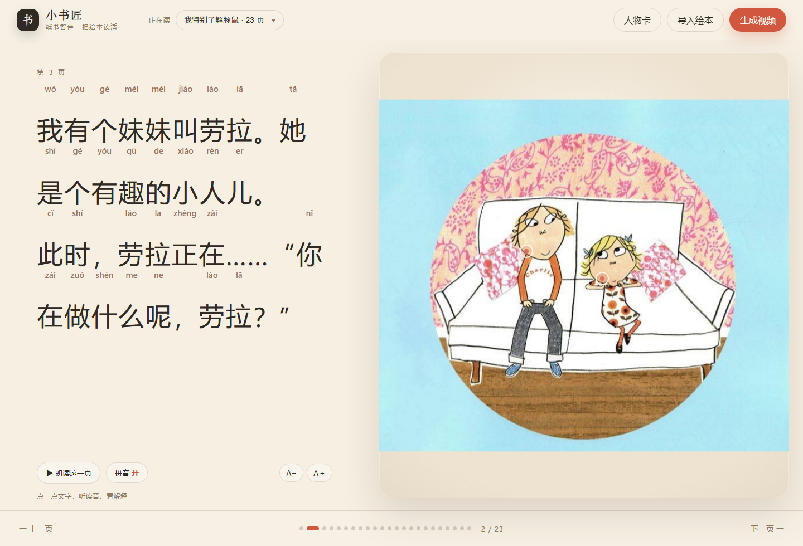

# 纸间生灵

把一本扫描的纸质绘本变成**可点的互动绘本**，再一键导出**带旁白的 16:9 短片**。

纸页之间，人物活过来——这就是“纸间生灵”。

不是"整页图加个运镜"：文字、拼音、插图、人物会被重新拆开、排版和关联。
左栏是大字 + 逐字拼音，右栏是清洗过的原插画；点字听读音、看含义，点画看这一页发生了什么，点人物卡认识角色。



人物墙里的角色不是贴纸：有切件的角色由**原图切出的身体 + 手臂**组成，手臂绕肩转轴摆动、挥手，
没有网格拉伸或扭曲。点开人物卡，她会转向你、说话，打破第四面墙。
这些切件、转轴和动作现在由一条 agent 链自动产出（`python -m book2real cast`），
Critic 不通过就退回肖像；没人认领的切件会以“agent 切好的候选”出现，写一行 `rig_from` 即可挂到角色上。
契约与指标见 [docs/AGENTS.md](docs/AGENTS.md)。


## 快速开始

```bash
pip install -r requirements.txt
python -m book2real models --fetch        # 可选：本地模型（8GB GPU 的 demo 档）
python -m book2real reader --books books --port 8770 --open

# 或先手动分析 / 人物链 / 2.5D 分层 / 出片
python -m book2real analyze --book books/charlie_lola
python -m book2real cast    --book books/charlie_lola
python -m book2real layers  --book books/charlie_lola
python -m book2real film    --book books/charlie_lola
```

打开页面后：

1. 选择书目（内置《我特别了解豚鼠》《迎国庆》）；
2. **导入绘本**：多选页面图片，自动按文件时间排序 → OCR → 拼音 → 清字 → 排版；
3. **生成视频**：后台逐页配音、排版、运镜、编码，完成后在弹窗里播放/下载。

> 本机实测（RTX 5070 Laptop 8GB / i9-14900HX）：`cast` 约 50 s（含 SD 修补），
> `layers` 23 页约 120 s（SAM + 深度 + 修补），显存峰值 < 3 GB。耗时随机器和负载波动。

## 2.5D 分层（本地 demo 档）

静止页不再靠"整页推近"，也不再靠整页晃动。`python -m book2real layers` 把每一页拆成
**背景板 + 人物层**，并给人物层一个来自深度图的独立位移量：

| 步骤 | 工具 | 8GB 实测 |
|---|---|---|
| 人物轮廓 | SAM ViT-B（box 提示） | ~0.7 s / 页 |
| 背景修补 | OpenCV NS/TELEA 自选 | < 0.1 s |
| 深度 | Depth Anything V2 small | ~0.3 s / 页 |
| 切件修补 | SD-1.5 inpainting（`cast --models` 开关） | ~1.5 s / 图 |

网页用 CSS `transform` 做视差（鼠标移动），16:9 成片复用同一份 `layers/index.json`。
每页记录 `outline`（sam/box）与 `inpaint`（inpaint/none），**没做干净就如实标注**，
不拿一块色块冒充修复。

已知边界：两个人物贴得很近、共用一个挖补区域时，背景修补会在人物边缘留下一点过渡；
干净平涂页没有这个问题。细节见 [docs/READER.md](docs/READER.md) 的 2.5D 一节。

## 本地 / 服务器分工

- **本地 8GB 能跑**：互动阅读、纸偶、分层、深度、SAM、SD-1.5 局部修补；
- **本地跑不动也不值得跑**：Qwen-Image-Edit 20B、Wan2.2 14B、HunyuanVideo —
  放到 GPU 服务器或调用 API，见 [docs/DEPLOY.md](docs/DEPLOY.md)。

## 已有能力

| 能力 | 实现 |
|---|---|
| 页面排序 | 按 `st_ctime` 归档，`ORDER.csv` 可追溯 |
| 文字识别 | rapidocr_onnxruntime（PP-OCR，离线） |
| 拼音 | pypinyin，逐字声调；按词换行（jieba） |
| 插画清字 | OpenCV Telea inpaint，去掉页上印刷字 |
| 点字 | 读音 + 本页词义 + 朗读 |
| 点画 | 场景讲解 + 人物热点 |
| 人物卡 | 从原图裁出，作为一致性/后续 I2V 的参考 |
| 人物 agent | `python -m book2real cast`：PageScout → CastClerk → Rigger → MotionDirector → Critic，自动切件/关节/动作/质检（[docs/AGENTS.md](docs/AGENTS.md)） |
| 2.5D | 阅读页保持原图静止；人物墙里用原图切件做肩部转轴、挥手/说话 |
| 旁白 | edge-tts 晓晓，缓存复用；失败回退浏览器语音 |
| 视频 | 16:9，左文右图，按旁白时长切镜，AAC 音轨 |

## 两条产品线

- **互动阅读**：`book2real/storybook.py` 生成 `reader/book.json` + 清洗后的插图，`reader_app.py` + `web/reader.*` 提供阅读器。
- **成片导出**：`book2real/storyfilm.py` 复用同一份 reader 包，渲染 16:9 短片；旧的 `run` 管线（分层视差 / 程序化微动 / pregen）仍在，用于样张与 I2V 预留。

## 文档

- [`docs/READER.md`](docs/READER.md) — 互动绘本的产品设计、分析管线、视频版式、开源选型与许可证
- [`docs/ARCHITECTURE.md`](docs/ARCHITECTURE.md) — 旧版 2.5D 渲染与编排
- [`docs/HANDOFF.md`](docs/HANDOFF.md) — 实测数据、已知问题、下一步

## 目录

```
book2real/
  storybook.py      OCR → 正文选择 → 拼音/分词 → 清字 → reader 包
  storyfilm.py      16:9 朗读短片（文字左 / 插图右 / 旁白）
  reader_app.py     互动阅读器 HTTP 服务 + 导入/出片任务
  web/reader.*      阅读器界面（无构建步骤）
  tts.py            edge-tts 旁白 + 缓存
  ocr / pinyin / segmentation 依赖放在 vendor/（离线演示）
books/<id>/          pages/ + book.json + curation.json + reader/
runs/                产物（gitignore）：互动片、旧管线成片、TTS 缓存
vendor/              pypinyin / jieba / edge-tts（比赛演示用，见许可证说明）
docs/                设计与交接
```

## 环境

> 仓库名仍保留 `Book2Real`（代码包名 `book2real` 不变），产品名称是**纸间生灵**。

Python ≥ 3.10，`ffmpeg` 在 PATH。依赖见 `requirements.txt`；仓库内 `vendor/` 已带
pypinyin、jieba、edge-tts，离线可直接跑（edge-tts 仍需网络；无网时回退浏览器/系统语音）。

```bash
pip install -r requirements.txt
```
