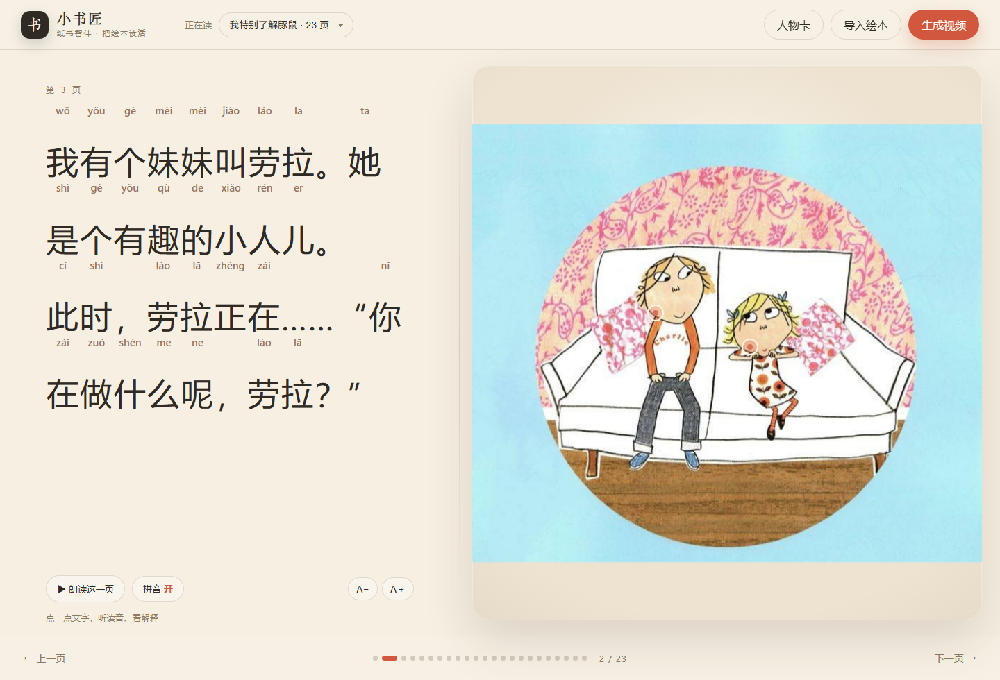
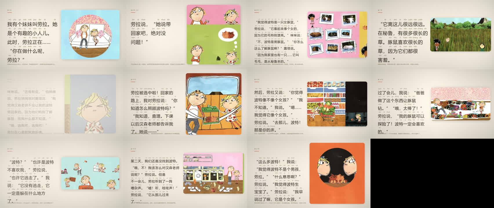

# 纸间生灵 · 互动绘本

> 从"一本扫描的纸质绘本"到"孩子能点、能听、能看的互动书"，再一键导出 16:9 的朗读短片。
> 不是把整页图加个运镜，而是把**文字、拼音、插图、人物**重新拆开、排布、再组织。



## 1 为什么重做

旧版把整页扫描图当成一张"海报"来运镜，问题不在运镜，在**信息没有重构**：

- 一页里文字和插画挤在一起，孩子看不清字；
- 文字印在画上，分层一动就出现"伪字"；
- 点不了、读不了、问不了，只是一个视频生成器。

新版把一页拆成四件事，各归其位：

| 要素 | 新位置 | 交互 |
|---|---|---|
| 故事文字 | 左栏大字，逐字拼音，按词换行 | 点字：读音 + 本页含义 |
| 插图 | 右栏完整插画，轻微呼吸/推近 | 点画：这一页发生了什么 |
| 人物/物体 | 人物卡 + 可选热点 | 点人物：是谁、在做什么 |
| 声音 | 每页旁白（edge-tts），点击即读 | 朗读按钮 / 点字读一读 |

## 2 三个入口

```bash
python -m book2real reader --books books --port 8770 --open   # 互动阅读器
python -m book2real analyze --book books/charlie_lola          # 只做分析，重建 reader 包
python -m book2real film    --book books/charlie_lola          # 导出 16:9 短片
```

网页里还可以：

1. **导入绘本**：直接多选页面图片，按文件时间排序；后台 OCR → 拼音 → 清字 → 排版，完成后自动打开。
2. **生成视频**：点右上角按钮，后台逐页配音、排版、运镜、编码；完成前可以继续读。

## 3 分析管线（导入之后自动完成）

```
pages/*.jpg
  │
  ├─ OCR            rapidocr_onnxruntime（PP-OCR 模型，Apache-2.0）
  │                  → 文字块 + 坐标 + 置信度
  ├─ 选正文列        按横向区间聚类，取汉字数最多的一列
  │                  → 去掉插画里的"长毛的/黑色的"这类标签
  ├─ 断句/分段       句末标点切分；长页自动拆成多个阅读屏
  ├─ 拼音            pypinyin（MIT），逐字带声调
  ├─ 分词            jieba（MIT），保证"小人儿""劳拉"不被行末拆开
  ├─ 清字            OpenCV Telea inpaint（Apache-2.0）
  │                  平涂色块用中值填充，其余用扩散修复
  └─ reader/book.json + reader/art/pNN.jpg
```

`curation.json` 是"人工校订层"，只覆盖需要覆盖的字段：

```jsonc
{
  "title": "我特别了解豚鼠",
  "characters": [{ "id": "lola", "name": "劳拉", "role": "妹妹",
                   "desc": "查理的妹妹，活泼、爱幻想。",
                   "crop": {"page": "p03", "from_original": true,
                            "box": [0.485, 0.315, 0.155, 0.29]} }],
  "pages": {
    "p03": {
      "text": "……",                       // 覆盖 OCR 结果
      "scene": "查理和劳拉坐在沙发上……",   // 点画讲解
      "words": [{"w":"有趣","py":"yǒu qù","mean":"好玩、让人感兴趣。"}],
      "spots": [{"name":"劳拉","box":[0.5,0.43,0.09,0.16],"desc":"……"}]
    }
  }
}
```

没有 curation 的书也能读：OCR 文本 + 拼音 + 清洗后的插图 + 通用字义（`glossary`）。

## 4 阅读器

- **左文右图**，桌面 46/54，平板/手机自动上下堆叠。
- 每个字是独立可点单元；拼音用绝对定位悬浮在字上方，**不撑开字距**。
- 按词换行（jieba），标点跟随前一个词，避免行首出现"。"。
- 点字弹层：拼音、所在词、本页含义、朗读；没有标注时用内置常用字义兜底。
- 点画：有热点显示"这是谁/在干什么"；没有热点时显示本页场景讲解。
- 人物卡：从原图裁出的角色图，作为角色一致性的"标尺"，也是后续 I2V 的参考图。
- 2.5D：整幅插图的缓慢推近 + 指针视差 + 漂浮微尘；不做会破坏画面完整性的分层切割。
- 朗读：优先 `/api/tts`（edge-tts 晓晓），失败回退浏览器 `speechSynthesis`。


## 4.4 一屏别放太多字：拆页 + 重新配图

一页绘本常常印着一大段话。把整段塞进一屏，孩子读不下去，图也只剩一个角落。
所以分析阶段会把**长页拆成 2–4 屏，每屏配一张自己的取景**：

| 规则 | 值 | 改哪里 |
|---|---|---|
| 每屏字数上限 | `64` 字（超过就拆） | `curation.json` → `"text_limit"` |
| 每页最多几屏 | `4` 屏 | `curation.json` → `"max_parts"` |
| 在哪里断 | 先按 `。！？；…`，长句再按 `，、：` | `storybook._split_text` |
| 取景 | 第 1 屏整页，之后逐级推近（1.0 / 1.3 / 1.55 / 1.75×） | `storybook._part_boxes` |

两条硬约束：

1. **文字一个字都不能改**：所有分片拼起来严格等于原页文字（不补引号、不删标点），
   拼音与分词都基于分片文字重新计算，孩子读到的仍是书上的原话。
2. **不要把人物切成两半**：推近时朝画面内容的重心取景；若这一页有手工热点，
   后续屏会框住角色（热点外留 10% 边），而不是横向/纵向硬切。
   低分辨率页（短边 < 700px）会自动降低推近倍率，避免放大后发糊。

实测《我特别了解豚鼠》：23 屏 → **31 屏**，最长一屏从 **107 字降到 74 字**，
平均 40 字；p04 变成“整页 → 中景 → 波特特写”，p09 变成“整页 → 三级推近”。

## 4.5 人物墙与纸偶（刚性切件，不扭曲）

目标不是“整页在动”，而是**角色自己动**：

- **人物墙**：按页面文字和角色表整理出查理、劳拉、波特、露塔、咪咪；卡片用**完整头部的矩形肖像**，不做抠像卡片，避免“半张脸”。
- **纸偶**：劳拉拆成 **身体 / 左手臂 / 右手臂** 三层，都是原图像素。背景是平涂红，手臂在红底上，切掉后只剩红，因此旋转不会出现“半只手”。
- **转轴**：两只手臂 `transform-origin` 在肩点，绕肩 ±18° 摆动；身体只做 4px 上下呼吸，**不做网格/非刚性变形**。
- **互动**：点开人物卡进入角色舞台；鼠标移动时整张纸偶做 ±5° 的 3D 转向（“看读者”），点“挥挥手”触发两轮挥手；角色用对话气泡说本页相关的话。
- **静止页**：阅读页插图不再做推近/呼吸/视差，避免“图在晃、人不动”的廉价感。


切图规范（这次踩过的坑）：

- 肖像卡必须从**原页**裁，不从已经裁过的 art 再裁；至少保留整个头部 + 下巴。
- 抠像只对**平涂背景**做；白底/红底用“与边框连通的背景色”判定，衣服内部的白色/红色由墨线包住，不会被误删。
- 手臂切件必须选**在背景上的肢体**；贴着躯干的手臂要先补画肩膀重叠边，否则一转就露洞。
- 复杂背景、遮挡、半透明水彩：交给 VLM 分割/修复（SAM、anime-segmentation、Recraft），并让 QA 检查“脸部完整率 / 背景残留率”。

开源参考：

- [Inochi2D](https://github.com/Inochi2D/inochi2d)：开源 2D 骨骼/变形网格；
- [DragonBones](https://github.com/DragonBones/DragonBonesJS)：骨骼 + 插槽 + 时间轴；
- [anime-segmentation](https://github.com/SkyTNT/anime-segmentation)：动漫角色抠像；
- [rembg](https://github.com/danielgatis/rembg)：通用去背景；
- [Thin-Plate-Spline Motion Model](https://github.com/yoyo-nb/Thin-Plate-Spline-Motion-Model)：整人驱动，但会连背景一起扭。

下一步：把“找角色 → 裁肖像 → 判断可切肢体 → 生成转轴 → QA”做成 agent 工具链；现在的劳拉纸偶是这条链的第一个产物，不再由人逐页手写动作。

### 4.6 实现：五个 agent 跑完这条链

```bash
python -m book2real cast --book books/charlie_lola    # 本次实测 12.9 s，纯 CPU（耗时随环境波动）
```

| Agent | 输出 | 位置 |
|---|---|---|
| `PageScout` | 每页主体 bbox / 面积 / 主色 / 置信度 | `reader/cast/entities.json` |
| `CastClerk` | 人物墙 + 候选框 + 无名候选 | `reader/cast/clerk.json` |
| `Rigger` | 刚体切件、肩/颈 pivot、安全摆幅 | `reader/cast/rig/<cid>.json` |
| `MotionDirector` | 每屏 beat（idle / wave / point / nod / speak…） | `reader/motion/<page>.json` |
| `Critic` | 眼睛成对、背景残留、关节开洞、接缝、动作舒适区、正文覆盖 | `reader/cast/critic.json` |

阅读器直接读 `reader/characters/characters.json`：有 `rig.parts` 的角色在人物卡上标“会动”，
点开按 `motion/<page>.json` 的 beat 播放；没人认领的切件显示在“agent 切好的候选”里，
可以点开挥手——这一步之后只差一个名字（在 `curation.json` 写 `rig_from`）。
契约、指标阈值与已知边界见 [`AGENTS.md`](AGENTS.md)。


## 5 视频：把同一套版式拍成 16:9

- 左栏大字 + 拼音，右栏插图卡片；与阅读器同一套内容，不重新生成画面。
- 每页时长由旁白音频决定：`max(3.2s, audio + 0.9s)`，避免"字没读完就切"。
- 运镜：插图 1.02 → 1.075 缓慢推近 + 轻微横移 + 光影扫过；首尾 7 帧淡入淡出。
- 旁白：edge-tts 逐页合成，ffmpeg 补齐静音后按镜头时长拼接，最后 mux AAC。
- 片头/片尾用同一张纸色背景，不喊口号。



## 6 实测（本机 RTX 5070 Laptop / i9-14900HX / ffmpeg 8.1.1）

| 项 | 数值 |
|---|---|
| 真书 | 《我特别了解豚鼠》21 页 → **31 个阅读屏**（64 字上限拆屏，每屏一张取景） |
| 互动包构建 | OCR + 拼音 + 清字 + 排版，约 2–3 分钟（含 21 页 OCR） |
| 阅读页 | `/` 首屏 < 1 s；切页即时 |
| 朗读首响 | edge-tts 首次约 1 s（之后命中缓存） |
| 成片 | **210.5 s / 1280×720 / 24fps / 带旁白** |
| 整本视频首渲 | **约 7.9 分钟**（23 屏时测；现在 31 屏，约 1.3×） |
| 单页视频 | 约 20–25 s |

**待优化**：整本视频渲染目前是单进程逐帧 PIL 合成，是最大的耗时项。下一步按页并行（`ProcessPoolExecutor`）预计可压到 3–5 分钟；TTS 命中缓存后不再走网络。

## 7 开源选型与许可证

| 能力 | 选用 | 许可 | 说明 |
|---|---|---|---|
| OCR | rapidocr_onnxruntime（PP-OCR） | Apache-2.0 | 离线、中文准、比 Paddle 全量轻 |
| 拼音 | pypinyin | MIT | 支持多音字词组、声调 |
| 分词 | jieba | MIT | 只用于换行，不参与内容生成 |
| 清字 | OpenCV Telea inpaint | Apache-2.0 | 平涂面板几乎无痕 |
| 旁白 | edge-tts（晓晓） | **GPL-3.0** | 演示/评测可用；商用需替换为 CosyVoice / Azure TTS 等授权方案 |
| 编码 | ffmpeg + libx264 | LGPL/GPL | 系统安装 |

> 合规提醒：edge-tts 是 GPL-3.0，仓库里的 `vendor/edge_tts` 只用于比赛演示；如果产品化，换成有商业授权的 TTS，或改用 Apache/MIT 的 CosyVoice/Piper + 授权音色。

## 8 与"好未来"场景的对应

- **早期阅读**：拼音、点读、逐字解释，直接对应低龄语文启蒙。
- **亲子共读**：一键朗读 + 页面讲解，家长不用备稿。
- **老师备课**：人物卡、场景讲解、重点词，可导出为课堂提问点。
- **内容生产**：同一份 reader 包同时产出互动页和视频，不用维护两套素材。
- **差异化**：不是"AI 重绘整本书"，而是"把原书的文字和画重新组织成可交互的阅读体验"——画面忠实、成本可控、可离线。

## 9 已知限制 / 下一步

1. **视频渲染慢**：按页并行 + 帧缓存，目标 3–5 分钟。
2. **插画清字仍有残影**：复杂纹理上的印刷字会留下淡痕；需要文字行 mask + patch-match / LaMa。
3. **实体识别靠人工**：当前热点/人物卡由 `curation.json` 标注；`python -m book2real cast` 已能
   自动找出主体、切件、生成动作并通过 Critic，但**跨页身份再认**仍需要特征模型
   （颜色直方图在绘本书上不可靠，实测余弦 0.3–0.5），所以切好的无名人物先放在
   “agent 切好的候选”里，由人写一行 `rig_from` 认领。
4. **问答是"预置解释"**：还没有自由问答/ASR；接口层已按 `实体 → 本页上下文 → 回答` 预留。
5. **TTS 依赖网络**：离线场景回退 SAPI 或预生成音频包。
6. **多音字/轻声**：pypinyin 已覆盖大部分，仍需要人工校订表处理书名、人名。

## 10 产品判断（为什么这样做）

面向低龄阅读，真正稀缺的不是"生成一段炫酷视频"，而是三件很土但很硬的事：

1. **可读**：字要够大、拼音要准、换行要按词，孩子读得下去。
2. **可问**：任何一个字、任何一个人物都能点，回答要贴着这一页，而不是百科。
3. **可信**：画面必须是原书的画，不能每一页重绘成另一个角色；人物卡就是"锚"。

由此得到的取舍：

- **不做全页生成**，做"文字/插图/人物"的重构；插画只清字、不重绘。
- **视频不是独立产品**，是同一份 reader 包的另一种输出；一次生产，两种交付。
- **交互先预置、再自由问答**：先把"点击命中率 / 首响 / 解释准确"做稳，再接 ASR + VLM，否则现场必然翻车。
- **离线优先**：OCR、拼音、排版、2.5D 全部本地；只有 TTS 可联网，断网自动降级。

可继续的产品化方向：

- **家长报告**：读了多久、点了哪些字、问了什么，形成"本周识字卡"。
- **老师模式**：把每页的 `words/scene` 导出成课堂提问单和板书。
- **角色一致性评测**：用人物卡裁图做 CLIP/DINO 相似度，量化"跨页一致率"。
- **I2V 高光镜头**：只对 2–4 个跨页做 I2V，人物卡作参考图，其余镜头保持确定性 2.5D。
- **语音伴读**：ASR + 本页实体索引 + 限长回答 + TTS，首响目标 ≤1.5 s。
